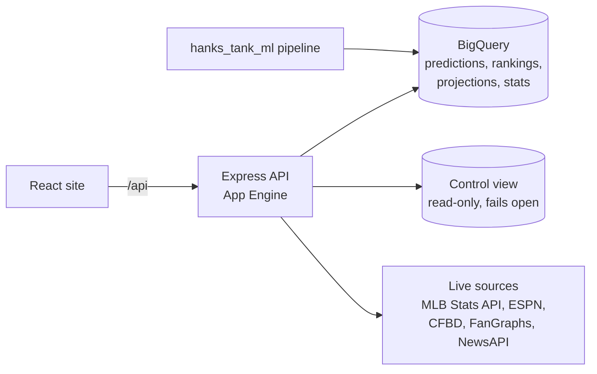

# Hank's Tank API

> **Live:** https://hankstank.com/api
> **Part of [hankstank.com](https://hankstank.com):** site in [hanks_tank](https://github.com/elijahcraig45/hanks_tank) · ML pipeline in [hanks_tank_ml](https://github.com/elijahcraig45/hanks_tank_ml)

The TypeScript/Express API behind hankstank.com. It serves MLB, NFL and college football
predictions, model scoreboards, power rankings, season projections, scouting reports and stats to
the React site. Model output is read-only here: the ML pipeline is the only writer of predictions,
rankings and simulations in BigQuery. This API reads them, adds live data where a page needs it, and
caches the result.

## What it does

- Serves every model's predictions per sport: the headline pick, its confidence tier, and a
  scoreboard that counts only predictions made before the game started
- Serves power rankings, season projections, the college scouting report and football stats
- Routes MLB data by season: past seasons from BigQuery, the current season from the live MLB Stats
  API, with tiered cache lifetimes
- Applies the model control plane (hide, pause, pin, banners) from a BigQuery view, and keeps
  working if that view is unavailable
- Runs a pick'em contest and archives news articles to BigQuery

## Architecture



## Key API areas

`:sport` is `mlb`, `nfl` or `cfb` (football routes take `nfl` or `cfb`).

| Area | Representative routes |
|---|---|
| Predictions | `GET /api/predictions/:sport/slate`, `/api/predictions/:sport/players`, `/api/predictions/:gamePk`, `/api/predictions/diagnostics` |
| Model scoreboard | `GET /api/models/:sport/compare`, `/api/models/mlb/totals-props` |
| Power rankings | `GET /api/rankings/:sport`, `/api/rankings/:sport/compare` |
| Season projections | `GET /api/season-sim/:sport`, `/api/season-sim/:sport/team/:team`, `/api/season-sim/:sport/export` |
| Football | `GET /api/football/:sport/predictions`, `.../predictions/accuracy`, `.../scouting`, `.../stats/leaders`, `.../stats/players`, `.../scoreboard`, `.../schedule`, `.../games/:gameId` |
| Pick'em | `GET /api/pickem/games`, `/api/pickem/leaderboard`, `/api/pickem/me`, `PUT /api/pickem/picks` |
| MLB stats | `GET /api/teamBatting`, `/api/teamPitching`, `/api/standings`, `/api/player/:playerId`, `/api/team/:teamAbbr`, `/api/statcast`, `/api/transactions`, `/api/scouting-reports` |
| News | `GET /api/mlb-news`, `/api/braves-news`, `POST /api/news/refresh` |
| Site status and health | `GET /api/site-status`, `GET /health` |

## Model control (read-only)

The site reads a small control view written only by the private lab (`mllab`): which models to
show, label / note / order overrides and a per-sport banner. Contract: `mllab/docs/MODEL_CONTROL.md`.

- Read: `SELECT * FROM hankstank.<CONTROL_DATASET>.model_control_current WHERE sport IN (...) OR sport = '*'`
  (`services/model-control.service.ts`). `CONTROL_DATASET` defaults to `control`.
- Cached 30 s per instance per sport; 2.5 s timeout; one query for all sports from `GET /api/site-status`.
- Fails open: any error, timeout or empty view means no overrides (`available: false`, `version: 'none'`), with one
  WARNING per failure window. The backend never writes control data and has no admin endpoint.
- Hidden models are removed from `/api/models/:sport/compare`, `/api/predictions/:sport/slate`, the legacy
  `/api/football/:sport/models/compare`, and (production key hidden) the legacy prediction endpoints return the games
  with prediction fields null and `hidden: true`.
- The control `version` is part of those routes' cache keys, and browser/edge `Cache-Control` max-age is capped at 60 s.
- Ranking columns: the sport-wide row (target `*`) may carry `rankings_show` (up to 3 custom orderings, in order, e.g.
  `season,results`; `none` = none) and `rankings_media` (poll columns, e.g. `ap,coaches`; `none` = none). Unset = no
  override. `GET /api/rankings/:sport` returns them as `meta.display` (`{show, media}`, filtered to the sport's catalog in
  `config/rankings.config.ts`; `null` = no override) with `meta.catalog`; rows are not filtered, the frontend draws the columns.
  That route has no server cache or `Cache-Control`, so there is nothing to key on the control version.
- Last known good: after a failed read the last successfully read state (same `version`) keeps applying for up to 6 h,
  then it fails open. One WARNING when the failure window opens and one when the remembered state expires; a good read
  replaces it at once (an empty view counts as a good read).
- `lifecycle` (live/shadow/archived, informational) is read from the view's `lifecycle` column, falling back to `role`;
  parsed entries expose both `lifecycle` and `role` (same value). Unrelated to the registry role.
- Stand-in (MLB compare and slate only): when the production key `v10` is hidden or paused by control, the response gets
  `stand_in: { model, label, reason, basis, n_games }` and `featured_default` is that model. Candidates are visible,
  non-derived (not elo/market) models with predictions for the games served; lowest season log loss on shared games when
  there are at least 50, else `sim_blend` then `logit3`. `stand_in` is `null` otherwise (always present on MLB bodies;
  football and the legacy prediction endpoints are unchanged).
- `GET /api/site-status` returns `{ generated_at, control_available, sports: { mlb|nfl|cfb: { banner } } }`, max-age 30.

## Production footprint

| Resource | Notes |
|---|---|
| Hosting | App Engine `default` service, reached through `https://hankstank.com/api/*` dispatch routing |
| Warehouse | BigQuery datasets for MLB, NFL and college football (current season and history), plus the `control` view |
| ML integration | Reads the prediction, shadow, rankings, season-projection and scouting tables written by `hanks_tank_ml` |
| Per-game scheduling | `/api/lineup/schedule-today` can still enqueue per-game Cloud Tasks for the Cloud Function fallback. Since 2026-10-05 the per-game schedule runs on the homelab and those queues are paused |
| CI | GitHub Actions runs lint, the Jest suite (415 tests) and the build on every push. The deploy job skips itself because no GCP credentials are configured, so deploys are manual (`npm run deploy`) |

## Stack

| Layer | Technology |
|---|---|
| Runtime | Node.js on App Engine standard |
| Language | TypeScript 5 |
| Framework | Express 4 |
| Data access | `@google-cloud/bigquery`, `@google-cloud/tasks`, `axios` |
| Testing | Jest + `ts-jest` |
| Logging | Winston + structured app logs |

## Local development

1. Install dependencies:
   ```bash
   npm install
   ```
2. Create `.env` from `.env.example`.
3. Set required environment variables:
   ```env
   GOOGLE_CLOUD_PROJECT=hankstank
   GOOGLE_APPLICATION_CREDENTIALS=/path/to/service-account.json
   NEWS_API_KEY=your-key
   PORT=8080
   ```
4. Start the app:
   ```bash
   npm run dev
   ```

## Useful scripts

| Command | Purpose |
|---|---|
| `npm run dev` | Compile and start the API locally |
| `npm run type-check` | Run TypeScript without emitting |
| `npm test` | Run Jest tests |
| `npm run build` | Compile to `dist/` |
| `npm run deploy` | Build and deploy to App Engine (needs `NEWS_API_KEY` exported; it is rendered into the gitignored `app.generated.yaml`) |
| `npm run deploy:prod` | Build and deploy to App Engine with `--promote` |

## Production routing

- `https://hankstank.com/api/*` and `https://www.hankstank.com/api/*` are dispatched to the backend App Engine `default` service.
- The App Engine hostname remains available as a direct fallback during deploys and routing changes.

## Repository structure

```text
src/
├── app.ts
├── config/
├── controllers/
├── data/
├── middleware/
├── routes/
├── services/
├── utils/
└── __tests__/
```

## License

MIT
